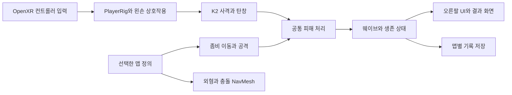
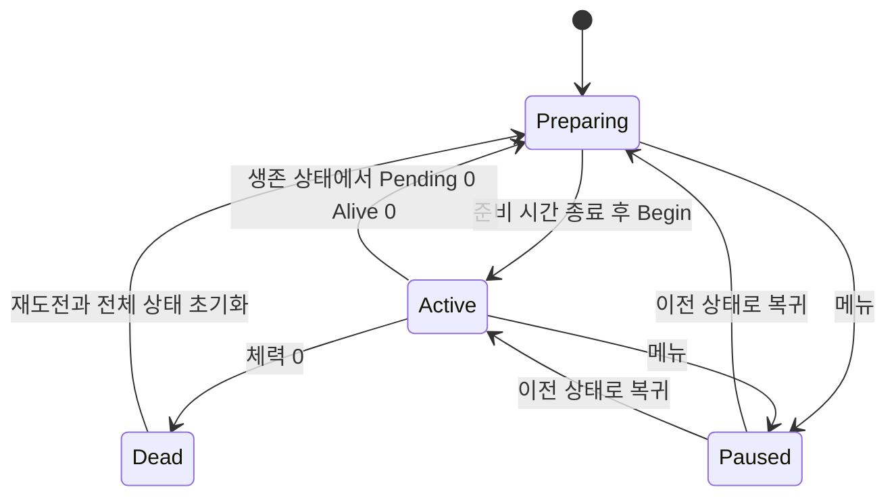

# 기술 설계

2026-09-20 갱신 · 구현 전 설계 · 기존 VR 템플릿 프로젝트를 사용하며 아래 자체 게임 시스템은 구현 전이다.

## 1 기본 구성

기존 `D:/Unity Project/Zombie Shoot VR/Zombie Shoot VR/` 프로젝트를 사용한다. 2026-09-20 기준 Unity 6000.3.23f1, VR 템플릿 10.0.0, XR Interaction Toolkit 3.5.1, URP 17.3.0, OpenXR 1.17.1, Input System 1.20.0을 개발 기준으로 한다. XRI 3.5.1은 `Packages/manifest.json`과 `Packages/packages-lock.json`에서 확인했다. 같은 버전의 Starter Assets와 API를 사용하고, 추가로 필요한 AI Navigation·Unity Test Framework는 설치 여부와 호환 버전을 확인해 잠금 파일에 기록한다. 프리뷰 패키지는 기본 경로에서 제외한다. G0에서 Windows OpenXR 런타임·양쪽 입력·기기 빌드를 검증한다. 설치 버전 확인만으로 기기 호환성 통과로 표시하지 않는다. [XRI 3.5 문서](https://docs.unity3d.com/Packages/com.unity.xr.interaction.toolkit@3.5/manual/index.html)

Windows x86_64 PC 빌드를 기준으로 하며 Quest 단독 Android 빌드는 만들지 않는다. GS 후보에서는 D3D12를 먼저 시험하고 해당 렌더러의 URP RenderGraph 조건을 맞춘다. GS에 필요한 설정을 확정하기 전에 후처리와 안티앨리어싱을 늘리지 않는다. [UnityGaussianSplatting](https://github.com/aras-p/UnityGaussianSplatting)



## 2 씬과 파일 책임

아래 경로는 향후 선택할 Unity 프로젝트 루트를 기준으로 한다. `Assets/VRFPS` 아래에 자체 코드를 두고 외부 에셋 원본은 `Assets/ThirdParty`에서 분리한다. 과도한 서비스 프레임워크나 네트워크 계층은 만들지 않는다.

| 경로 | 책임 |
|---|---|
| `Assets/VRFPS/Scenes/Bootstrap.unity` | 설정·저장 로드, 맵 메뉴 진입 |
| `Assets/VRFPS/Scenes/Combat.unity` | 공통 PlayerRig, 게임 진행, UI, 적 풀 |
| `Assets/VRFPS/Scenes/Maps/Room.unity` | 방 외형·충돌·NavMesh·MapRoot |
| `Assets/VRFPS/Scenes/Maps/Classroom.unity` | 강의실 외형·충돌·NavMesh·MapRoot |
| `Assets/VRFPS/Scenes/Tests/InteractionLab.unity` | 총기·탄창·벽·적의 검증용 작은 시험장 |
| `Assets/VRFPS/Runtime/Player/PlayerRigController.cs` | 스틱 이동·회전, HMD 기준 캡슐, 입력 활성 상태 |
| `Assets/VRFPS/Runtime/Player/LeftHandInteractor.cs` | 왼손이 잡는 대상 하나의 소유권·해제 |
| `Assets/VRFPS/Runtime/Weapons/FireGate.cs` | 발사 허용 조건의 순수 규칙 |
| `Assets/VRFPS/Runtime/Weapons/K2Controller.cs` | 양손 방향 계산, 발사 간격·총구 충돌·총알 판정 |
| `Assets/VRFPS/Runtime/Weapons/MagazineState.cs` | 장착 여부와 잔탄, 제거 시 잔탄 폐기 |
| `Assets/VRFPS/Runtime/Weapons/MagazineToken.cs` | 실제 탄창 물체의 새 탄창·폐기 상태 |
| `Assets/VRFPS/Runtime/Weapons/MagazineSocket.cs` | 왼손 탄창 삽입 위치·각도 검증 |
| `Assets/VRFPS/Runtime/Weapons/AmmoPouch.cs` | 허리 기준 새 탄창 공급, 생성 상한 |
| `Assets/VRFPS/Runtime/Combat/IDamageable.cs` | 총알·근접·투사체가 공통으로 호출하는 피해 계약 |
| `Assets/VRFPS/Runtime/Combat/VitalState.cs` | 체력, 피격 보호, 한 번만 적용되는 회복 |
| `Assets/VRFPS/Runtime/Enemies/ZombieController.cs` | 탐색·이동·공격 준비·회복·사망 상태 |
| `Assets/VRFPS/Runtime/Enemies/AcidProjectile.cs` | 투사체 이동, 충돌, 수명, 중복 피해 차단 |
| `Assets/VRFPS/Runtime/Progression/WaveProgress.cs` | 대기·생존 적 수, 도달 웨이브, 중복 해결 차단 |
| `Assets/VRFPS/Runtime/Progression/RunPhase.cs` | 준비·전투·일시정지·사망 열거형 |
| `Assets/VRFPS/Runtime/Progression/RunController.cs` | 준비·전투·일시정지·사망·재도전 조정 |
| `Assets/VRFPS/Runtime/Progression/SpawnDirector.cs` | 유효 생성점 선택, 유형·동시 수 제한 |
| `Assets/VRFPS/Runtime/Maps/MapDefinition.cs` | 맵 ID, 씬 이름, 맵별 동시 수·거리 설정 |
| `Assets/VRFPS/Runtime/Maps/MapRoot.cs` | 씬의 외형·충돌·시작점·생성점 참조 |
| `Assets/VRFPS/Runtime/Persistence/RecordStore.cs` | 맵별 최고 기록, 저장 실패·백업 복구 |
| `Assets/VRFPS/Runtime/UI/ForearmHUD.cs` | 오른팔 기준 위치와 체력·웨이브·처치 표시 |
| `Assets/VRFPS/Runtime/UI/MenuController.cs` | 맵 선택·설정·정지·결과·재도전 |
| `Assets/VRFPS/Runtime/Feedback/CombatFeedback.cs` | 소리·진동·입자 효과, 동시 수 제한 |
| `Assets/VRFPS/Runtime/Pooling/PoolRegistry.cs` | 적·투사체·탄창·효과 회수와 수량 통계 |
| `Assets/VRFPS/Runtime/Configuration/GameBalance.cs` | 06의 수치를 ScriptableObject로 제공 |
| `Assets/VRFPS/Tests/EditMode/` | 발사·탄약·체력·웨이브·기록 순수 규칙 시험 |
| `Assets/VRFPS/Tests/PlayMode/` | 씬 전환·재시작·풀·충돌 통합 시험 |

런타임과 시험은 각각 `VRFPS.Runtime.asmdef`, `VRFPS.EditModeTests.asmdef`, `VRFPS.PlayModeTests.asmdef`로 구분한다. 테스트 어셈블리만 테스트 프레임워크를 참조한다. 매니저를 모두 전역 싱글턴으로 만들지 않고 씬 참조와 생성자 인자로 연결한다.

## 3 주요 계약

아래는 인터페이스 설계다. 이 문서의 코드가 컴파일·실행 검증된 구현이라는 뜻은 아니다. 메서드 이름과 의미를 04의 작업 및 테스트에서 동일하게 사용한다.

```csharp
namespace VRFPS {
  public enum RunPhase { Preparing, Active, Paused, Dead }
  public enum EnemyKind { Melee, Ranged }

  public interface IDamageable {
    // sourceId는 중복 타격 조사용, activeTime은 정지 시간을 제외한 초.
    bool ApplyDamage(int amount, int sourceId, double activeTime);
  }

  public static class FireGate {
    public static bool CanFire(bool leftGrip, bool inserted,
        int rounds, RunPhase phase, bool muzzleBlocked) =>
      leftGrip && inserted && rounds > 0 &&
      phase == RunPhase.Active && !muzzleBlocked;
  }
}
```

| 타입 | 외부에 제공할 계약 | 상태 의미 |
|---|---|---|
| `MagazineState` | `MagazineState(int capacity)`; `int Rounds {get;}`; `bool Inserted {get;}`; `int Eject()`; `bool InsertFresh()`; `bool TryConsume()` | 생성 시 가득 장착. Eject 반환값은 폐기량이며 회수 가능한 탄약이 아님 |
| `VitalState` | `VitalState(int maxHealth, int healPerWave, double protectionSeconds)`; `int Health {get;}`; `bool Damage(int amount,double activeTime)`; `bool HealForClear(int wave)` | 초기 체력 최대. 사망 이후 피해·회복 거부. 회복한 wave 중복 거부 |
| `WaveProgress` | `int ReachedWave {get;}`; `int Pending {get;}`; `int Alive {get;}`; `int Kills {get;}`; `void Begin(int wave,int quota)`; `bool RegisterSpawn(int enemyId)`; `bool ResolveEnemy(int enemyId,bool playerKill)`; `bool TryClear()` | Begin에서 도달 갱신. 생성 성공만 Pending 감소. 같은 ID 해결 1회 |
| `RunController` | `RunPhase Phase {get;}`; `double ActiveTime {get;}`; `void StartRun(MapDefinition map)`; `void SetPaused(bool paused)`; `void EndRun()` | 매 프레임 피해·사망 처리를 클리어·회복보다 먼저 확정 |
| `SpawnDirector` | `bool TrySpawn(EnemyKind kind,out int enemyId)` | 위치·거리·경로·유형 상한 만족 시 실제 생성 후 true |
| `K2Controller` | `void SetLeftGrip(bool held)`; `void SetCombatEnabled(bool enabled)` | 손 해제 즉시 연사 중지. 총은 오른손 앵커에서만 기준 위치 결정 |
| `RecordStore` | `RecordStore(string directory)`; `BestRecord Read(string mapId)`; `bool TryUpdate(string mapId,int reachedWave,int kills)`; `bool Save()`; `static bool IsBetter(BestRecord old,int reachedWave,int kills)` | 높은 웨이브 우선, 같으면 처치 수. Save 실패 시 false와 UI 알림. 시험 시 독립 폴더 주입 |
| `BestRecord` | `int reachedWave`; `int kills` | 저장할 최고 도전 한 건의 두 값 |
| `MapDefinition` | `string mapId`; `string sceneName`; `int maxAlive`; `int maxRangedAlive`; `float minSpawnDistance` | `room`, `classroom`은 저장에 쓰는 불변 ID |
| `MapRoot` | `Transform playerSpawn`; `Transform[] enemySpawns`; `Transform visualRoot`; `Transform collisionRoot` | 모든 참조와 NavMesh 접근 가능성을 로드 시 검사 |

잘못된 quota, 음수 피해, 중복 Begin은 개발 중 경고 또는 인자 예외로 발견한다. 저장 파일의 잘못된 값은 로드 단계에서 거부한다. 진행 시스템은 메모리상의 `ReachedWave`를 저장하고 ‘클리어 수+1’로 계산하지 않는다.

## 4 총과 왼손의 소유권

K2의 주 잡기 위치는 오른손 앵커에 고정한다. 양손 방향은 오른손 주 앵커에서 왼손 보조 앵커를 향하는 벡터와 오른손의 상방 기준으로 계산하고 모델의 잡기 오프셋을 보정한다. 양손 위치가 겹쳐 벡터가 거의 0이면 이전 유효 방향을 유지한다. 총의 변환을 XRI와 자체 코드가 동시에 쓰게 하지 않는다.

왼손의 소유 대상은 `None`, `Foregrip`, `InsertedMagazine`, `LooseMagazine` 중 하나다. 이미 탄창을 잡은 상태에서 앞부분을 동시에 잡을 수 없다. 오른손에는 K2용 앵커만 적용하며 일반 물체를 잡아 총이 떨어지는 경로를 만들지 않는다.

탄창은 `Fresh`, `Inserted`, `Discarded` 상태를 갖는다. Fresh만 빈 삽입구에 결합 가능하다. 장착 탄창 탈거 시 잔탄을 0으로 폐기하고 Discarded로 바꾼다. 버린 탄창을 다시 집더라도 삽입 대상으로 인정하지 않는다. 허리 보급은 왼손이 비어 있고 새 그립 입력이 들어왔을 때 1개만 생성한다. 그립을 누르고 있는 매 프레임마다 생성하지 않는다.

허리 위치는 HMD의 수평 위치와 몸통 추정 방향을 천천히 따라가게 하되 고개를 숙인 pitch는 적용하지 않는다. 초기 왼쪽 허리 위치를 기기에서 보정할 수 있게 한다. 실제 허리 추적을 전제로 하지 않는다.

## 5 전투와 공간

총알은 총구에서의 Raycast로 판정한다. 발사 전 오른손 근처 기준점부터 총구까지 별도 검사를 하여 총 모델이 벽을 뚫었을 때 반대편으로 발사되지 않게 한다. 플레이어·자기 총기는 총알 마스크에서 제외한다. 근접 공격은 거리, 시야 차단, 준비 동작 후 실제 타격 시점의 유효성을 함께 검사한다. 투사체는 이전 위치부터 다음 위치까지 구간 충돌 검사와 최초 충돌 1회 처리를 사용한다.

| 물리 레이어 | 역할 |
|---|---|
| WorldSolid | 벽·바닥·큰 가구, 이동·총알·투사체 차단 |
| PlayerBody | 플레이어 피격과 캡슐, 자기 총알 제외 |
| Enemy | 좀비 피격·경로 분리, 총알 대상 |
| Weapon | 총 모델, 플레이어 몸에 물리 충격 전달하지 않음 |
| Magazine | 손 상호작용·바닥 충돌, 이동 장애물로 사용하지 않음 |
| Projectile | 플레이어·월드 충돌, 발사 주체와 충돌 제외 |
| VisualOnly | 스캔 외형, 충돌은 WorldSolid 대리 구조가 담당 |

GS 외형과 물리 콜라이더는 서로 자동으로 맞지 않는다. 보이지 않는 콜라이더는 화면 깊이를 만들지 않으므로, 벽 뒤 적을 가려야 한다면 적절한 깊이 전용 렌더 구조가 별도로 필요하다. 그 구조가 스캔을 잘라 먹는지, 두 눈에서 같은 위치인지 시험한다. 실패하면 텍스처 메시로 전환한다.

적은 NavMeshAgent가 이동을 담당하고 애니메이션 루트 모션은 기본 비활성화한다. 공격 시 이동을 멈추고 준비→판정→회복 순서로 처리한다. 죽은 적은 즉시 공격·피격을 끄고 사망 표시 뒤 풀로 회수한다. 경로 고착은 5초마다 진행량을 검사하고 유효 지점으로 재배치한다. 재배치는 처치를 늘리거나 남은 적 수를 줄이지 않는다.

## 6 웨이브와 사건 처리 순서



프레임 내 피해 요청을 처리하고 사망 여부를 먼저 확정한다. 사망이면 EndRun을 1회 실행하고 회복·다음 웨이브 처리를 건너뛴다. 살아 있고 TryClear가 처음 true가 되면 HealForClear를 호출한 다음 준비 상태로 간다. 다음 전투를 실제 시작할 때 Begin을 호출한다. 적 생성은 true로 성공한 뒤 RegisterSpawn으로 등록하며 생성점 실패는 할당량을 소비하지 않는다.

일시정지는 전투 시계와 입력, 적 AI·Animator·Rigidbody 동작을 정지한다. XR 추적·메뉴·오디오 UI는 계속 갱신한다. 단순히 전투 코루틴 하나만 멈춰 투사체가 계속 움직이지 않게 한다. 재개 시 손 소유권·겹침 상태를 재평가한다.

## 7 저장과 씬 수명

기록은 `Application.persistentDataPath/records-v1.json`에 UTF-8로 저장한다. 아래는 형식 예시이며 실제 달성 기록이 아니다. Unity JsonUtility를 사용하면 Dictionary 대신 직렬화 가능한 배열과 필드로 구현한다.

```json
{"schemaVersion":1,"records":[{"mapId":"room","reachedWave":6,"kills":42},{"mapId":"classroom","reachedWave":3,"kills":12}]}
```

임시 파일 작성·닫기·검증 후 본 파일로 교체하고 이전 정상 파일은 `.bak`으로 보존한다. JSON 오류·지원하지 않는 스키마·음수 값을 만나면 백업을 시도하고 둘 다 실패하면 빈 기록으로 시작하며 오류를 알린다. 저장이 없는 맵의 Read는 reachedWave 0, kills 0인 BestRecord를 반환한다. 최고 비교 시 웨이브와 처치 수를 각각 다른 도전에서 조합하지 않는다. 저장 실패가 결과 화면을 막아서는 안 된다.

메뉴에서 Combat과 선택 맵만 로드한다. 다른 맵으로 갈 때 기존 맵을 언로드하고 적·탄창·투사체·이벤트 구독을 해제한다. 재시작은 체력 100, 장착 탄창 30, 처치 0, 도달 0, 첫 준비 상태로 돌아간다. 영속 객체와 맵 객체를 섞어 파괴된 Transform 참조가 남지 않게 한다.
