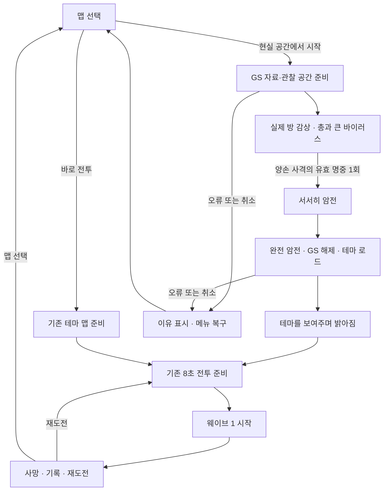

# GS 현실 공간 → 테마 맵 전환 상세 설계

2026-10-20 · P13 설계 · **문서화 완료, 기능 구현·GS 자료 취득·VR 검증은 미완료**

요구사항 기준은 [02 PRD](02-requirements.md)의 R21~R28, 실행 순서는 [12 구현 계획](12-gs-comparison-plan.md), 인수 절차는 [08 테스트 계획](08-test-plan.md)의 T21~T28을 따른다. 기존 P01~P12의 결과를 새 기능의 검증 결과로 재사용하지 않는다.

## 1. 목적과 사용자 결정

직접 촬영한 실제 방과 그 구조를 바탕으로 만든 폐가의 관계를 플레이어가 체험으로 이해하게 한다. 사용자가 지정한 흐름은 **실제 공간을 보고 있다가, 손에 든 총으로 공중의 큰 바이러스를 쏘면 서서히 어두워지고, 다시 밝아지면서 테마 맵이 보이고 게임이 시작되는 것**이다.

- 현실 공간의 외형에 Gaussian Splatting(GS)을 사용한다. 이것은 저장된 촬영 결과이며 실시간 Quest 패스스루가 아니다.
- 전환 뒤에는 현재 저장된 Room/Classroom 테마 씬과 기존 전투를 사용한다. GS가 자동으로 가구를 분류하거나 폐가·폐교 프리팹으로 변환하는 기능은 아니다.
- 사용자가 선택한 **1번 비교 방식만** 추가한다. GS 공간에서 좀비와 싸우는 2번 시험장, 임의 사용자 방 업로드, NeRF/GS 학습 알고리즘 자체 개발은 제외한다.
- 바이러스는 사용자 지정 [anyaachan의 Coronavirus // virus model](https://sketchfab.com/3d-models/coronavirus-virus-model-362ca23f5a584c5bb84dc9d9a25ff73e)을 사용한다. 대체 도형은 자동 시험용으로만 허용하고 최종 외형으로 보고하지 않는다.

### 설계를 위한 기본안과 확정 범위의 구분

아래 세부값은 사용자 발언을 인용한 확정값이 아니라 구현·실기 검증을 시작할 **설계 기본안**이다. 조정 시 [06](06-gameplay-balance.md)과 시험을 함께 갱신한다.

- 첫 구현·인수 대상은 **내 방 GS → Room 폐가**다. Classroom 폐교는 기존 직접 전투를 유지한다. 강의실 자체 GS를 확보하면 같은 흐름을 후속 적용하며 Room GS로 대신하지 않는다. 첫 단계 완료를 두 맵 GS 완료로 표현하지 않는다.
- 맵 메뉴에 `현실 공간에서 시작`과 기존 `바로 전투` 진입을 구분한다. GS 준비가 끝난 Room의 첫 항목이 비교 체험 진입점이다. 데이터 미준비 시 이유를 표시하고 기존 전투를 별도로 선택할 수 있게 한다.
- 도입부는 한 번의 유효 명중으로 전환한다. 사망 후 재도전은 테마 맵의 준비 단계로 돌아간다. 다시 비교하려면 메뉴에서 현실 공간 진입을 선택한다. 별도 양방향 토글·비교 점수·업적은 만들지 않는다.
- 최초 실행의 기존 Controls 안내는 유지하고, 이를 닫고 맵을 선택한 뒤 새 도입부에 들어간다.
- 도입부는 정해진 관찰 지점에서 둘러보고 조준한다. 스틱 평행 이동과 A 점프는 끄고 기존 연속 회전은 허용한다. HMD·양손 추적은 전 상태에서 유지한다.

## 2. 어떤 기술을 가져오고 무엇을 직접 만드는가

| 부분 | 공급·책임 | 산출물 |
|---|---|---|
| 현실 공간 촬영 | 사용자 직접 촬영 | 앱 원본·GS 내보내기·치수·촬영 조건 |
| GS 데이터 생성 | Scaniverse 등 기존 도구, 실제 설치 앱의 기능 확인 | Gaussian 속성이 있는 PLY 또는 지원 SPZ |
| Unity GS 표시 | 기존 렌더러를 검증 후 도입 | 잠근 버전·설정·라이선스·변환 자산 |
| 공간 대응 | 프로젝트에서 직접 설계 | 현실/테마 관찰 앵커, 방향·바닥·크기 보정 기록 |
| 바이러스 상호작용 | 프로젝트에서 직접 구현 | 총기 명중·한 번만 수락·피드백 |
| 전환과 게임 시작 | 프로젝트에서 직접 구현 | 상태 제어, VR 암전, 로딩·취소·복구, 전투 시작 차단 |
| 검증·최적화 | 프로젝트에서 직접 수행 | 양안·입력·가림·메모리·회귀 시험과 재현 자료 |

제작 기여는 **기존 GS 기술을 활용한 현실 공간 복원 및 VR 게임 통합**이다. 외부 렌더러나 앱을 직접 개발했다고 주장하지 않는다. COLMAP 및 graphdeco 학습 코드는 필수 의존성으로 추가하지 않는다.

후보 렌더러는 [UnityGaussianSplatting](https://github.com/aras-p/UnityGaussianSplatting)이다. 공식 문서는 생성된 GS PLY/SPZ 입력, Windows DX12/Vulkan 요구와 DX11 미지원, MIT 코드 라이선스를 안내한다. 이 사실은 현재 프로젝트의 URP/OpenXR 호환성 검증을 대신하지 않는다. 2026-10-20 조회 기준이며 실제 채택 시 커밋을 잠근다.

## 3. 현재 기준과 선행 확인

기존 사용자 확인 빌드는 `Builds/Windows/WallFix/AbandonedSchool.exe`, gameplay 소스 `cdc635f`, GUID `9723fbe2fa094de7be98e4c75f72b1b2`다. 두 맵의 전투 흐름 인수는 [진행 기록](../progress.md)을 따른다. 문서 기준 커밋 `63b378b`까지 GS 구현은 없다.

| 입력·환경 | 현재 근거 | P13 진입 조건 |
|---|---|---|
| 방/강의실 FBX | 메시 구조 참조 자료 확보 | FBX를 GS로 이름만 바꾸거나 변환했다고 주장하지 않는다 |
| 실제 방 GS | 대화·출처 기록에 사용 가능한 파일 미확인 | 파일 경로, 해시, 포맷, 앱 버전, 임포트 가능 여부 확인 |
| 그래픽 API | 이전 사용자 Player.log는 DX11·MultiPass | 별도 시험본에서 DX12 우선 검증, 필요할 때만 Vulkan 대안 평가 |
| Unity 환경 | 6000.3.23f1 / URP17.3.0 / OpenXR1.17.1 / XRI3.5.1 | 기존 버전을 유지하고 설치본과 후보 렌더러의 조합을 시험 |
| 바이러스 ZIP | 다운로드·외부/내부 CRC 검사 완료 | OBJ 재질 수동 연결과 가벼운 렌더 자산 준비 |

WallFix를 덮어쓰거나 기본 프로젝트의 그래픽 API부터 바꾸지 않는다. GS 시험본은 별도 경로로 빌드한다. 그래픽 API는 실행 중 바꿀 수 있다고 설계하지 않으며, 새 실행 파일은 시작부터 선택한 API로 동작해야 한다. 따라서 GS뿐 아니라 기존 두 전투 맵도 그 API에서 다시 시험한다.

## 4. 화면과 플레이 순서

1. 메뉴 선택 시 이전 전투 세션을 정상 정리하고 도입부용 관찰 씬을 준비한다. 로딩 중 중복 클릭은 무시한다.
2. 실제 방의 특징이 잘 보이는 지점에 플레이어를 둔다. 총과 양손은 현재 추적 위치로 표시하고 오른팔에는 전투 수치 대신 `공중의 바이러스를 쏘세요` 안내를 보여준다.
3. 큰 바이러스는 관찰 시작 정면의 빈 공간에 고정된 월드 위치로 둔다. 시선에 계속 붙어 다니지 않는다. 배치가 벽·책상·총·메뉴에 가려지면 앵커를 수정한다.
4. 기존 양손 사격으로 맞히면 명중 소리/짧은 시각 반응을 한 번 내고 바이러스 추가 피격과 발사를 잠근다. 처치·웨이브·저장 기록은 바꾸지 않는다.
5. 두 눈과 손·총·GS를 함께 가리는 검정 페이드를 약1.2초 진행한다. 카메라를 흔들거나 강제로 움직이는 연출은 넣지 않는다.
6. 알파1에서 GS 렌더러/버퍼를 해제하고 테마 씬을 로드한다. 바닥·충돌·NavMesh·관찰 앵커가 준비돼야 밝아지기 시작한다. 로드가 느리면 검정 바탕의 짧은 진행 문구와 취소 메뉴를 보여준다.
7. 암전 상태에서 대응 지점으로 이동하고 기존 시점1.15배 설정과 추적 오프셋을 적용한다. 밝아지는 약1.2초 동안 이동·사격·적 생성은 차단한다.
8. 완전히 밝아진 뒤에만 새 도전 초기화와 기존8초 준비를 시작한다. HP100·장착30발·처치0·도달0으로 시작하며 준비 종료 후 웨이브1이다. 도입부에서 쓴 탄약과 버린 탄창은 전투에 넘기지 않는다.

## 5. 상태와 입력 계약

새 도입부 상태는 `IntroPhase`로 분리한다. 기존 `RunPhase`의 Preparing/Active/Paused/Dead를 도입부를 위해 가짜로 Active로 만들지 않는다. 전투 기록에 영향을 주는 `StartRun`은 밝아짐 종료 뒤 한 번만 호출한다.

| IntroPhase | 총·재장전 | 스틱·점프 | 적·기록·시계 | 종료 조건 |
|---|---|---|---|---|
| LoadingReality | 차단 | 차단 | 전투 비활성 | 자료 준비 완료 |
| RealityPreview | 기존 양손/벽 검사·수동 재장전 허용 | 연속 회전만 허용 | 도입부 전용 시계, 기록 미갱신 | 바이러스 명중 |
| FadingOut | 차단 | 차단 | 전투 비활성 | 검정 알파1 |
| Switching | 차단 | 차단 | 전투 비활성 | 테마 검증·GS 해제·리그 배치 완료 |
| FadingIn | 차단 | 차단 | 전투 비활성 | 검정 알파0 |
| Complete | 기존 전투 규칙으로 반환 | 기존 규칙 | 새 도전 초기화·8초 준비 | 기존 전투 시스템 담당 |
| Returning / Failed | 차단, 메뉴만 허용 | 차단 | 늦은 요청 무효화 | 소유 자원 정리·메뉴 복구 |

도입부 동안 메뉴의 표시 권한도 IntroController가 가진다. 기존 MenuController.OnPhaseChanged의 Dead→Result 자동 표시가 도입부 정리/전환을 덮지 않게 하며, 기존 도전을 끝내는 정리는 도입부 시작 전에 수행한다.

일시정지는 별도 플래그로 기억한다. RealityPreview에서는 입력·도입부 시계·바이러스 동작을 멈추고 XR 추적과 메뉴는 유지한다. 페이드 도중에는 알파 진행도 멈춘다. 비동기 로드는 백그라운드에서 끝날 수 있지만 일시정지 중 화면 전환·게임 시작은 하지 않는다. 재개 시 손 상태를 재평가하고 트리거를 한 번 놓아야 다시 발사된다. 페이드 위의 메뉴는 양안에 읽히도록 별도 순서로 그리며, 이 레이어는 게임 세계가 비치는 예외로 쓰지 않는다.

### 명중과 총기의 소유권

- `IntroVirusTarget`은 현재 `IDamageable.ApplyDamage(int amount, int sourceId, double activeTime)`에 연결한다. 첫 양의 피해, 등록된 플레이어 총 ID, RealityPreview, 미정지·미소비 조건을 모두 확인한다.
- 현재 총 Raycast는 trigger collider를 무시한다. 바이러스는 일반 피격 Collider를 사용하되 플레이어 이동과 충돌하지 않는 전용 `IntroTarget` 레이어로 둔다. Enemy 풀·WaveProgress에 등록하지 않는다.
- 총알 마스크는 관찰 공간의 WorldSolid와 IntroTarget만 포함한다. 가구·벽 뒤 바이러스는 맞지 않으며 총구 관통 검사도 유지한다. 바이러스의 느슨한 렌더 외곽보다 과도하게 큰 판정 구체를 사용하지 않는다.
- `K2Controller`의 현재 Fired/EmptyTriggered와 기존 소리를 재사용한다. 도입부 전용 총·별도의 가짜 사격 소리를 만들지 않는다.
- `RunCombatBindings`와 새 도입부가 같은 총 상태를 번갈아 쓰지 않도록 단일 `WeaponContextRouter`를 둔다. `WeaponContext`는 Disabled/Preparing/Intro/Combat으로 구분한다. 도입부·메뉴가 우선권을 가지며 종료 시 기존 전투 상태에서 다시 계산한다.
- Intro에서는 준비된 입력 시계만 증가하고 Combat에서는 기존 `RunController.ActiveTime`을 쓴다. 시계 소유권 변경 시 발사 간격을 재설정하여 새 세션의0초와 이전 절대시간을 비교하지 않는다. 총 Phase에 의존하던 왼손·보급·피드백도 같은 컨텍스트를 따른다.

## 6. 실제 방과 확대된 게임 맵의 대응

실제 방 GS는 약4.3×3.5m의 원본 기준 크기로 보정한다. 현재 폐가는 공간2배, 가구 기본1.5배에서 사용자가 위치·방향·크기를 다시 편집한 결과다. **GS 전체를2배 확대한다고 최신 가구와 정확히 겹치지 않는다.** 강의실도 원본 약14×6.3m와 게임 공간2배를 구분한다.

- `RealityAnchor`와 `ThemeAnchor`를 각각 사람이 지정한다. 문·책상·침대처럼 알아볼 수 있는 특징 최소3개를 대응표에 기록한다.
- 바닥 높이와 yaw 기준을 정하고, GS 단위 보정에는 서로 다른 방향의 기준 길이2개를 사용한다. 기존 방 치수는 근사값임을 표시하고 정밀 실측으로 주장하지 않는다.
- 눈높이1.15 보정은 양쪽에서 유지한다. 현실 데이터의 크기1:1과 사용자의 보정된 가상 시점을 구분한다. 리그 전체나 총·손을2배 확대하지 않는다.
- 리그 이동은 암전 중에만 수행한다. 현재 HMD의 로컬 수평 오프셋을 보상하고 관찰 방향의 상대 yaw를 테마 앵커로 전달한다. XR 카메라의 추적 pose 자체를 덮어쓰지 않는다.
- 전투 시작 시 기존 ResetPlayerAndWeapon이 다시 다른 위치로 이동시키지 않도록, 초기 배치는 새 `PrepareMap`에 분리하고 `BeginPreparedRun`은 지정 시작 위치를 유지한다. 재도전은 기존 맵 시작점으로 돌아간다.
- 새 전환 앵커는 최신 저장 씬의 비어 있는 바닥에 정한다. 필요하면 프로필에서 기존 playerSpawn을 참조한다. 가구를 자동 재배치하거나 초기 맵 생성기를 다시 실행하지 않는다.
- GS 구간의 숨은 충돌은 원본 크기 관찰 공간에만 맞춘 단순 바닥·벽·큰 장애물이다. 확대 테마 맵의 Collider/NavMesh를 그대로 복사하지 않는다. GS 자체는 충돌 표면으로 간주하지 않는다.
- 실제 머리 이동으로 촬영 범위를 벗어나면 안내를 표시한다. 불완전 스캔 너머로 스틱 탐험을 허용하지 않는다. 실물 방과 가상 공간의 물리적 정합을 보장하지 않는다.

## 7. 컴포넌트·씬·자료 경계

현재 실제 코드 경로를 기준으로 한 변경안이다. 아래 새 이름은 제안 계약이며 아직 파일이 존재하지 않는다. 구형03 문서의 예시와 충돌하면 P13에는 이 계약을 적용한다.

| 파일/단위 | 책임·연결 |
|---|---|
| `Runtime/Intro/ComparisonIntroController.cs` | 상태 전환·취소 세대 ID·중복 시작 차단. 씬, 총, 페이드의 소유권 조정 |
| `Runtime/Intro/RealityIntroProfile.cs` | mapId, 관찰 씬 경로, RealityAnchor/ThemeAnchor 키, 보정·페이드값·자료 식별자 |
| `Runtime/Intro/RealitySceneRoot.cs` | 관찰 앵커·원본 크기 충돌·바이러스 참조 유효성 검사 |
| `Runtime/Intro/IntroVirusTarget.cs` | 피해 계약, 한 번만 소비, `Triggered` 이벤트 |
| `Runtime/Intro/VrScreenFade.cs` | 양안 전체 검정 알파와 메뉴보다 앞선 세계 가림, unscaled time 기반·정지 플래그 준수 |
| `Runtime/Weapons/WeaponContextRouter.cs` | 단일 입력/발사 컨텍스트와 시계 소유권 |
| `Runtime/Progression/CombatSceneEntry.cs` | 메뉴의 현실 진입·기존 직접 전투 분기, Busy/오류 표시 |
| `Runtime/Progression/CombatSession.cs` | `PrepareMap`과 `BeginPreparedRun` 분리, 기존 `StartMap` 래퍼 유지 |
| `Runtime/UI/MenuController.cs` | 도입부 정지·재개·취소를 분기, 기존 재도전 의미 유지 |
| `Runtime/Intro/Rendering/` | 선택 GS 패키지 어댑터만 배치, 별도 asmdef로 패키지 API 격리 |
| `Scenes/Reality/RoomReality.unity` | 방 GS·관찰용 충돌·앵커·바이러스. 별도 리그·AudioListener 없음 |
| `Scenes/Maps/Room.unity`, `Classroom.unity` | 현재 저장된 테마 외형·충돌·NavMesh를 보존 |

표의 경로는 Unity 프로젝트의 `Assets/VRFPS/` 기준이다. Runtime 기본 어셈블리는 GS 패키지 타입을 직접 직렬화하지 않는다. 데이터 로드·표시·해제는 `IRealityPresentation` 어댑터로 한정하고, 자동 시험에서는 가짜 어댑터로 오류·시간 초과를 재현한다. 실제 GS 렌더 검증을 가짜 어댑터 시험으로 대체하지 않는다.

### 로딩과 GPU 메모리

공통 Combat 씬의 리그와 메뉴는 유지한다. GS는 하나만 로드하고 암전 뒤 GS 소유 렌더러·GPU 버퍼를 해제한 다음 테마를 로드하는 순차 경로가 기본이다. GPU 자원 해제는 패키지의 수명 API로 확인하며, Renderer 끄기나 GC만으로 해제됐다고 간주하지 않는다. 양쪽 전체 공간을 상시 동시 렌더하는 구조는 쓰지 않는다. 테마 로드 뒤에도 프레임당 페이드·추적·취소 UI가 갱신돼야 한다.

초기 검정 최소 유지0.25초, 각 로딩 단계 제한30초를 설계값으로 둔다.30초가 지나면 실패 UI와 메뉴 복귀를 제공한다. Unity 로드 작업이 즉시 취소 불가능하면 요청 세대를 무효화하고 완료 후 소유 씬을 해제한다. 늦게 끝난 이전 요청이 현재 메뉴나 새 맵을 덮지 않게 한다. `allowSceneActivation=false`로 대기하며 후속 언로드 큐까지 막는 방식은 사용하지 않는다. 미완료 정리가 남으면 새 전환 시작을 잠그되 메뉴·종료는 동작한다.

## 8. 실패와 복구

| 상황 | 동작 | 판정 |
|---|---|---|
| GS 파일 없음·잘못된 PLY·지원하지 않는 SPZ | 현실 진입 불가 이유 표시, 기존 직접 전투 유지 | GS 완료 아님 |
| 해당 PC의 API·XR 조합 실패 | 기존 WallFix 보존, 시험본 오류 기록 | R27 미통과, 몰래 메시로 대체하지 않음 |
| 총기 한 손·빈 탄창·벽 가림 | 기존 발사 제한·재장전 안내 | 명중 이벤트 없음 |
| 연사·중복 피해·빠른 맵 클릭 | 첫 요청만 수락 | 로드/전환/게임 시작 각1회 |
| 페이드 중 정지·포커스 상실 | 입력 차단, 추적 유지, 진행 정지 | 재개 시 새 트리거 요구 |
| 명중 후 취소·장면 파괴·종료 | 요청 무효화, 이벤트 해제, 자원 반환 | 이후 전투가 시작되지 않음 |
| 테마 로드·NavMesh·시작점 검사 실패 | 전투 시작 금지, 읽을 수 있는 오류·메뉴 | 검정 화면에 영구 고립 금지 |
| 재도전·메뉴 재진입 | 재도전은 테마 준비, 새 현실 진입은 소비 상태 초기화 | 이전 바이러스·버퍼·탄창 남지 않음 |

## 9. 자산·출처·재현

바이러스 ZIP 경로·해시·라이선스 근거는 [출처 기록](../asset-provenance.md)에 있다. OBJ의 MTL에 텍스처 경로가 없으므로 diffuse 후보·roughness를 직접 대조하고 URP 재질로 연결한다. `color.png`, `color11.png`, 외부 `cede.png`의 역할을 이름만으로 확정하지 않는다. 재질 선택·단순화·회전/크기 조정을 가공 내역에 남긴다.

개인 공간 원본 촬영·FBX·GS 원본과 가공 GS는 기본 Git 업로드에서 제외한다. P13 자산 도입 전에 폴더와 meta까지 제외 규칙을 준비한다. 로컬에서는 원본 해시, 생성기/렌더러 버전, 압축 설정, 앵커·척도, 출력 해시, 복원 명령을 manifest로 보관한다. 기존 소스 ZIP에는 새 GS가 없으므로 P13 완료 후 새 로컬 복원 묶음을 만든다.

기존 Method A의 **구조 참조 FBX는 최종 테마 씬 의존성에서 제외**하는 규칙은 유지한다. 다만 새 비교 빌드에는 사용자가 요청한 현실 표시용 **가공 GS만 별도 관찰 씬 의존성으로 포함**한다. 출처 촬영 원본 전체나 다른 공간 파일을 함께 넣지 않는다. 이 예외는 공개 업로드·개인 공간 공개 허가를 뜻하지 않는다.

## 10. 통과 기준과 현재 상태

- 사용자 흐름: 실제 방을 알아보고 바이러스 한 번 사격 → 양안 암전 → 현재 폐가 →8초 준비→전투가 자연스럽게 연결된다.
- 논리: 미리보기·암전·밝아짐 중 적0, 새 도전 시작0, 처치/도달 기록 변경0. 취소된 시도는 게임 시작0. 성공한 시도만 StartRun1회다.
- 기존 기능: 양손 사격·수동 재장전·버린 탄창10초·진동·A 점프·가구 통로·벽·좀비 접근·사망·기록·재도전 회귀가 없어야 한다.
- XR: 양눈에서 GS/총/바이러스 가림과 검정 덮임이 일치하고 고개 움직임에도 가장자리 누출이 없어야 한다. 흰 프레임·한쪽 눈 누락·추적 정지가 없어야 한다.
- 수명: 현실 진입/취소/전투 전환10회에서 소유 씬·구독·GPU 버퍼가 기준 상태로 돌아오고 리그·AudioListener가 중복되지 않는다.
- 성능: 기존72Hz CPU/GPU 각각 p95≤12.5ms 목표를 유지하며, GS 구간과 전환 로드 구간은 별도 표시한다. 전투 평균으로 GS 부하를 숨기지 않는다. 현재 성능 로그 수집 보류는 유지하며 미측정을 통과로 표시하지 않는다.

현재 완료된 것은 사용자 요구 정리, 자산 취득 확인, 설계·작업·시험 문서 연결뿐이다. GS 파일 확보, 렌더러 채택, 실제 코드, 빌드, 새 기능 Quest Pro 인수는 모두 남아 있다.

## 11. 선택한 접근과 대안

**채택 설계:** GS 관찰 씬과 테마 전투 씬을 암전으로 연결한다. 현재 게임을 보존하며 렌더러의 책임과 전투 규칙을 분리할 수 있고, 데이터 크기에 따라 암전 로드 시간이 생긴다.

**미채택 대안:** 전체 GS와 테마를 동시 로드해 계속 왕복하면 비교는 빠르지만8GB GPU에서 메모리·가림 부담이 커진다. 처음부터 GS 공간에 전투를 넣으면 충돌·AI·가림까지 새로 검증해야 하며 사용자가 이번에 선택한 범위를 벗어난다. FBX만 보여주는 임시 검증은 가능하지만 GS 기능 완료로 제출하지 않는다.

기술 근거: [Unity GS 렌더러](https://github.com/aras-p/UnityGaussianSplatting), [렌더 파이프라인 통합](https://github.com/aras-p/UnityGaussianSplatting/blob/main/docs/render-pipeline-integration.md), [Scaniverse 안내](https://www.nianticspatial.com/docs/scaniverse/quickstart/), [GS 생성·활용 안내](https://www.nianticspatial.com/docs/nsdk/how-to/ar/gaussian_splat/). 실제 모바일 앱 메뉴·파일과 로컬 Unity 시험 결과를 함께 기록한다.
